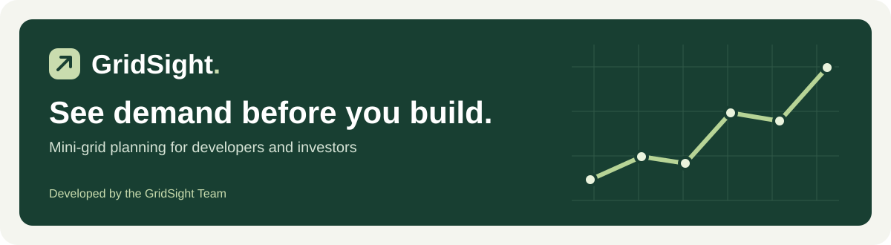
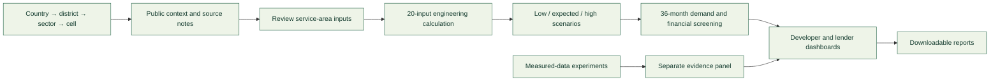

<p align="center">
  
</p>

<p align="center">
  <a href="https://gridsight-0al3.onrender.com/">Open the live app</a> ·
  <a href="docs/JUDGES_GUIDE.md">Judge's guide</a> ·
  <a href="data/README.md">Explore the data</a> ·
  <a href="docs/README.md">Documentation</a>
</p>

[](https://github.com/siltanukifilie/GridSight/actions/workflows/checks.yml)

# GridSight

**Mini-grid demand planning for developers and investors.** Estimate electricity
needs, explore growth and productive use, and understand financial risks before
committing to a project.

Built for the **Global Energy Hackathon, Brief 03: Predict mini-grid demand before
building**. The current release is **v1.12**. Rwanda has the richest public-data
coverage, including all **15 Bugesera sectors**. Location selectors cover the eight
EAC countries; data depth and local validation are not equal across them.

> **Evidence boundary:** the planning dashboard uses a transparent engineering
> calculation and editable scenarios. Its low / expected / high range is **not a
> calibrated confidence interval**. Real measured-data experiments are available
> separately; they do not validate a new Rwanda site or its three-year growth.

## Try it in five minutes

1. [Open GridSight](https://gridsight-0al3.onrender.com/). Free hosting may take
   about a minute to wake.
2. Choose **Mini-grid developer**. Select Rwanda → Bugesera District → a sector
   → a cell, or use a clearly labelled synthetic demo.
3. Review the service-area assumptions in **Community**, then update the dashboard.
4. Compare daily, weekly, monthly and yearly energy, the 36-month demand curve,
   productive-use scenarios and financial stress in **Overview / Feasibility**.
5. Switch to **Investor / lender**, inspect **Evidence**, then download a report.

Use non-confidential inputs only. This public demo has no secure user accounts;
the role switch changes the workspace, not access permissions.

## What each user gets

| Mini-grid developer | Investor / lender |
| --- | --- |
| Location-based public context and editable service-area inputs | Read-only review of the same demand inputs |
| Expected energy, illustrative peak and low / expected / high scenarios | Forecast assumptions, drivers and evidence limitations |
| Three-year connection, appliance and business-growth scenarios | Downside demand, affordability and repayment stress |
| Productive-use opportunities and sizing warnings | Financial screening and downloadable review reports |

## How it works



Whole-sector statistics are **not** copied into a small mini-grid's customer
counts. Measured studies remain separate from the planning equation. Missing
observations remain unavailable, not invented zeros.

## Data you can inspect

The data used by the released app is committed to this repository with source
notes, units, scope and checksum inventories. No account or training run is
needed to inspect the following CSVs.

| Dataset | What is included | What it establishes |
| --- | --- | --- |
| [Bugesera features](data/processed/bugesera_site_features.csv) | 15 sectors, 78 fields; census, buildings, services and derived context | Screening context, **not metered demand** |
| [Sector ranking](data/processed/bugesera_site_priority_ranking.csv) | 15 candidate sectors and score components | A relative shortlist, not feasibility or verified off-grid status |
| [Hourly measured features](data/operational/operational_features.csv) | 1,540 qualified examples from Rwanda, DR Congo and Haiti | Existing-site operational power, in kW |
| [Hourly model predictions](data/operational/predictions.csv) | 4,216 validation/test prediction rows | Eight approaches compared on later hours, not unseen sites |
| [Kenya/Nigeria held-out predictions](data/transfer_uncertainty/held_out_predictions.csv) | 237 site/horizon/month predictions | Operational transfer-error evidence requiring prior consumption |
| [Synthetic sites](data/synthetic_sites.csv) and [monthly records](data/synthetic_monthly.csv) | 500 fictional sites and 18,000 simulated months | Reproducible demos and legacy reference-model tests |

See the [data catalogue](data/README.md) for geographic snapshots, dictionaries,
provenance, exclusions and source-specific reuse terms. Haiti and Nigeria are
external study references, not extra countries in the location selector.

## Deliverables and honest limits

| Brief 03 deliverable | Current implementation | Remaining evidence gap |
| --- | --- | --- |
| Demand estimate with a range | Location workflow, 20 inputs and scenario bands | Matched pre-construction inputs and metered outcomes; calibrated uncertainty |
| Growth after connection | 36-month connection, appliance and productive-use scenarios | Observed first-years histories for calibration |
| Held-out metered-site validation | Separate operational transfer study and local validation tools | Validation of the **current Rwanda pre-build model** |
| Plain-language explanation | Customer-group contributions, assumptions and lender report | Field verification of assumptions |
| Safe meter-data sharing proposal | Operator pilot, blank templates and governance gates | Partner approval and a secure hosted transfer workflow |

No paying customer, avoided-capital saving, investment approval or nationwide
prediction accuracy is claimed. [Read the review guide](docs/JUDGES_GUIDE.md).

## Run locally

Tested with **Python 3.14.4**. Use **Node.js 22** for the JavaScript tests.
The committed data and frozen reference model are sufficient to start the app;
**do not retrain or download raw data to run the demo**.

```bash
git clone https://github.com/siltanukifilie/GridSight.git
cd GridSight
python3.14 -m venv .venv
.venv/bin/python -m pip install -r requirements-web.txt
GRIDSIGHT_PUBLIC_DEMO=1 GRIDSIGHT_LOW_MEMORY=1 bash run.sh
```

Open [localhost:8050](http://127.0.0.1:8050/). The public-demo flag keeps meter
uploads disabled. Omit it only for a permissioned, private local study; do not
disable it on a public server. [Deployment and privacy](docs/DEPLOYMENT.md).

### Test

```bash
.venv/bin/python -m pip install pytest==9.2.0
GRIDSIGHT_LOW_MEMORY=1 OPENBLAS_NUM_THREADS=1 OMP_NUM_THREADS=1 .venv/bin/python -m pytest -q
node --test tests/*.test.cjs
.venv/bin/gunicorn --config gunicorn.conf.py --check-config 'app:create_app()'
```

GitHub Actions runs the backend, interface-logic and production-configuration
checks. See the [verification record](docs/TEST_REPORT.md) for tested scope and
browser limitations. Software tests are not measured forecasting accuracy.

## Repository map

```text
GridSight/
├── app.py                 Flask API and report routes
├── src/                   Demand, finance, evidence and validation logic
├── static/                Dashboard JavaScript, CSS and brand assets
├── templates/             App and printable report templates
├── config/                Country and planning assumptions
├── data/                  Public context, measured studies and synthetic demos
├── models/                Frozen synthetic reference model
├── reports/               Reproducible synthetic evaluation results
├── scripts/               Collection, preparation and review utilities
├── tests/                 Backend and interface tests; synthetic fixtures
├── docs/                  Judge guide, architecture and methods
│   └── archive/           Clearly labelled development history
└── render.yaml            Existing free Render deployment configuration
```

## Team, contribution and reuse

**Developed by the GridSight Team.** See [team and acknowledgements](AUTHORS.md).
AI-assisted implementation and remaining submission work are described in the
[disclosure](docs/DISCLOSURE.md).

Contributions should preserve source attribution, privacy protections and
measured-versus-synthetic distinctions. See [CONTRIBUTING.md](CONTRIBUTING.md).
Data retains its original, mixed licences; the repository does not grant a
blanket software or data licence. See [reuse and attribution](docs/REUSE.md) and
[third-party notices](THIRD_PARTY_NOTICES.md).
