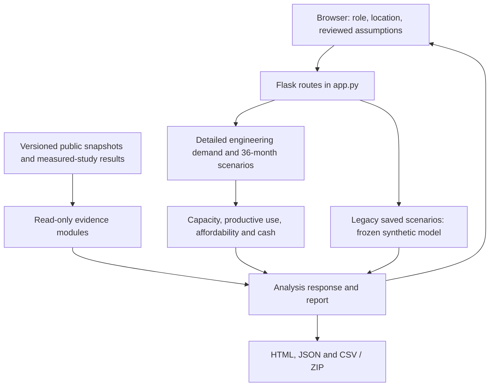

# Architecture and evidence boundaries

GridSight is a Flask application with server-rendered HTML, a JavaScript/SVG
dashboard, local versioned snapshots and a frozen synthetic reference model.
Render runs one Gunicorn worker. There is no hosted user database or automatic
model-retraining job.

## Main components

| Component | Main files | Responsibility |
| --- | --- | --- |
| Application | `app.py`, `gunicorn.conf.py`, `render.yaml` | APIs, reports, public-upload guards and deployment |
| Location | `src/geography.py`, `src/rwanda_data.py`, `src/context.py` | Country hierarchy, source-aware proxies, explicit assumptions |
| Demand | `src/detailed_inputs.py`, `src/connection.py`, `src/domain.py` | Detailed energy accounting, time basis and connection scenarios |
| Planning | `src/feasibility.py`, `src/planning_scenarios.py` | Sizing, growth, productive-use and financial stress |
| Evidence | `src/prepared_evidence.py`, `src/operational_evidence.py`, `src/transfer_uncertainty.py`, `src/bugesera_ranking.py` | Verify and display separate data/study snapshots |
| Local validation | `src/detailed_validation.py`, `src/statistical.py`, `src/maintenance.py` | Permissioned studies and reviewed update lifecycle; disabled uploads on public demo |
| Legacy reference | `src/model.py`, `models/forecast.joblib` | Frozen model trained on fictional communities; not the default 20-input equation |
| Interface | `static/`, `templates/` | Two workspaces and printable reports |

## Rules that prevent misleading joins

- Whole-sector public context does not overwrite service-area counts. Geographic
  matching uses country, district and sector, not coincident cell names.
- A measured hourly target in **kW** is not a monthly energy label in **kWh**.
- KIT or Kenya/Nigeria outcomes are not joined to unlabelled Bugesera sectors.
- Scenario multipliers and simulated input bands are not reported as calibrated
  confidence. Operational residual evidence is not applied to the planning curve.
- Missing/changed pinned evidence becomes unavailable. It is not replaced with
  plausible sample scores. A zero and an unavailable value remain distinct.
- The role switch shares one project and is not authentication or authorization.

## Update boundaries

Running the app never retrains a model. Collection/build utilities deliberately
replace snapshots and should run only for a separately reviewed data refresh.
The public release contains study data and results, not a live hourly-inference
service or the complete upstream experiment training environment.

See [data](../data/README.md), [script guide](../scripts/README.md),
[methods](FEASIBILITY_METHODS.md) and [deployment](DEPLOYMENT.md).
